# Useful Information About Me :nerd_face:

## University Projects :school:

I have previously worked on Data Science projects during my Statistics Degree at University.
- These projects included data mining, data and statistical analysis and writing analytical reports.
- To complete these projects, I've worked with programming languages such as Rstudio and Python :computer:.

One of my major projects was for a _Programming and Text Analytics with R_ module. My task was to analyse\
the text frequencies between two TedTalk speakers, _Eric Whitacre_ and _Amanda Palmer_, using data mining\
techniques from libraries in R such as **dplyr** and **ggplot2**. Through these results, I wrote an analytical\
report in _Rmarkdown_ format, showing my methodologies, analyses and conclusions.

# Working with Git & Github :keyboard:

### Checking the status 

The image below demonstrates the git command, `git status`.
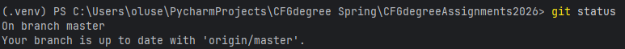

### Creating a branch

The image below demonstrates the git commands `git branch new_branch` and `git branch`.
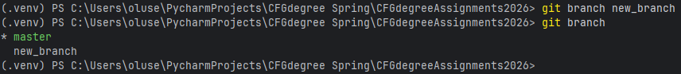

### Adding files to a branch

The images below demonstrates the git commands, `git add adding_file.txt` and `git add img_2.png`.
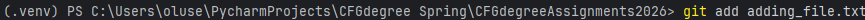
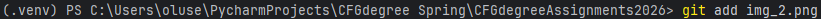

### Adding commits with meaningful messages

The image below demonstrates the git command, `git commit -m "Added new headline with 2 images"`.
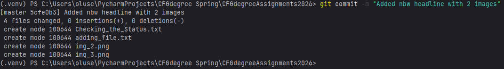

### Demonstration for opening a pull request

 The following images show the process for opening a pull request, after using the command `git push origin new_branch`.

 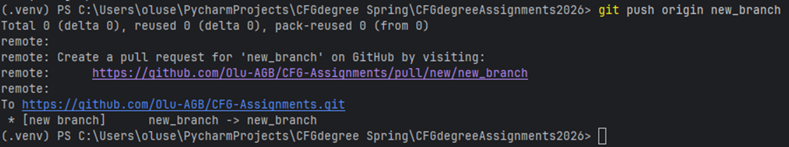
 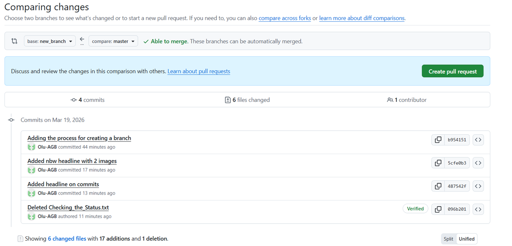
 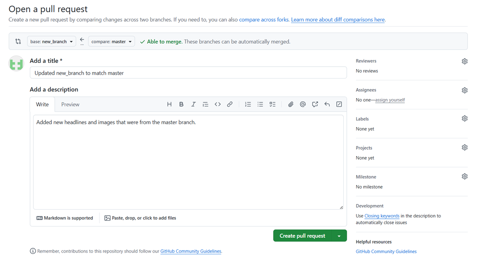
 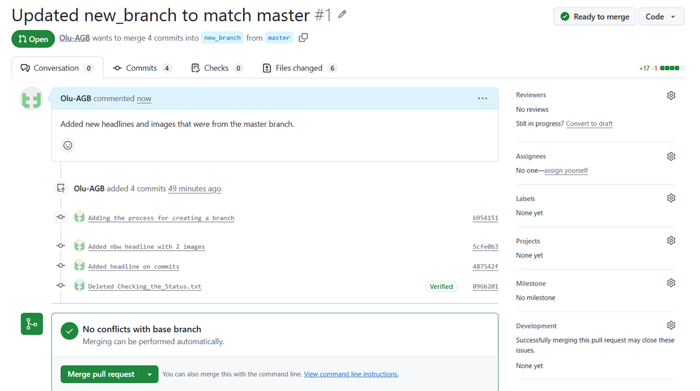

### Merging and deploying to main branch

The following images show the process for merging and deploying to main branch after the command `git merge new_branch`.

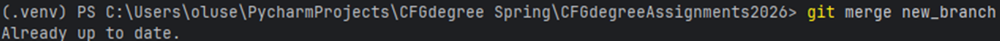
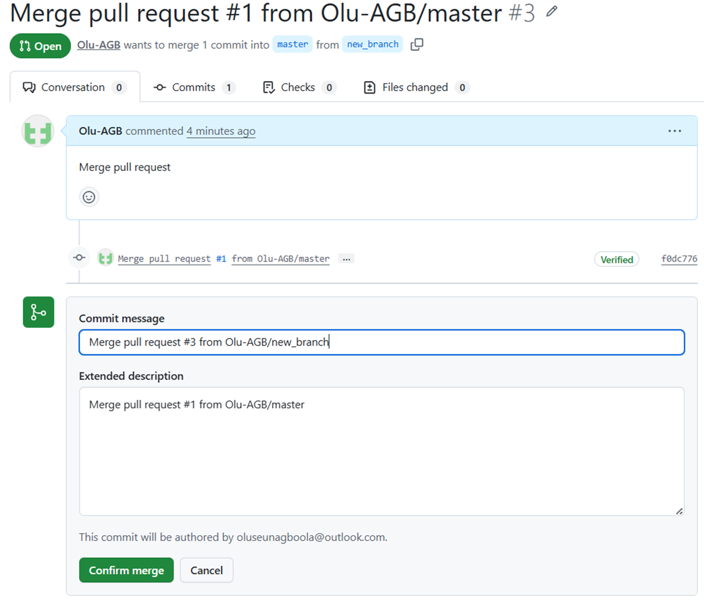
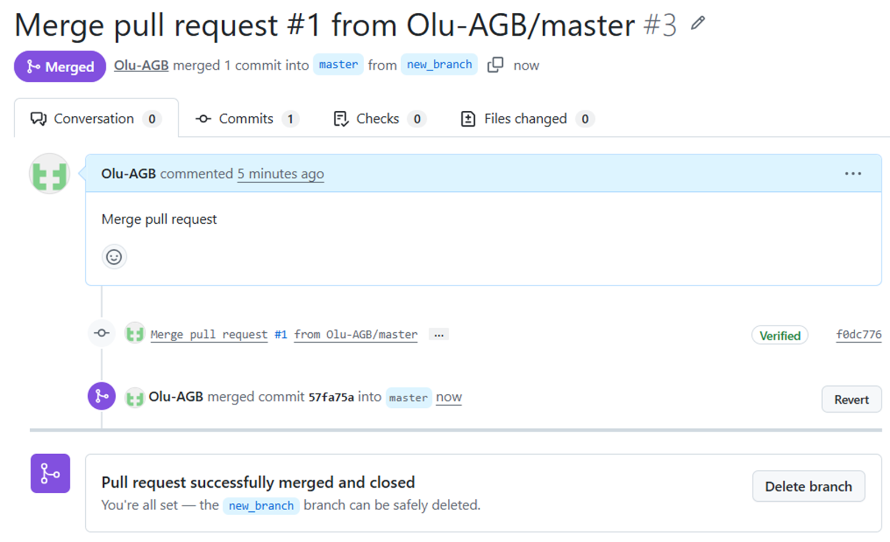

# Descriptions for .gitignore and requirements.txt :scroll:
\
The **.gitignore** file shown in the repository is used to store files and folders for Git to ignore. This can be helpful\
for keeping certain files you don't want in your repository.

\
The **requirements.txt** file contains the specific versions of all installed packages. With this, you can freeze the\
requirements of an environment on one computer, allowing you to replicate your environment on a different computer.
